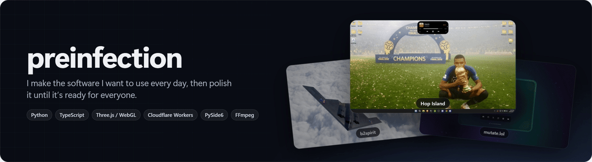
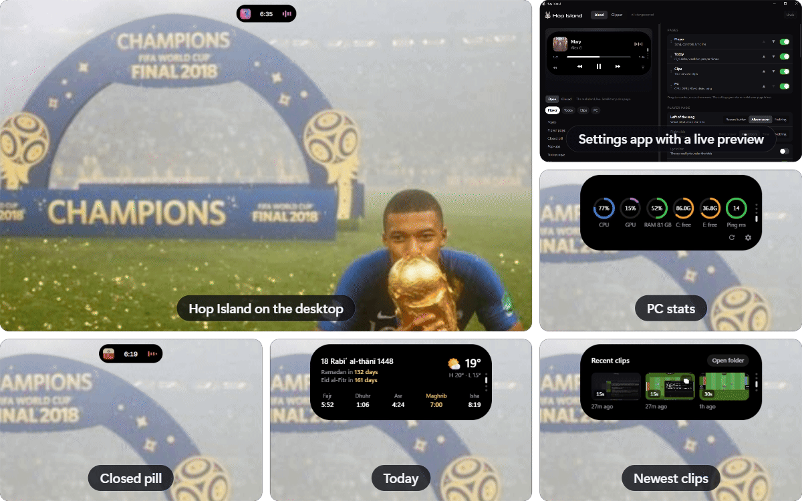
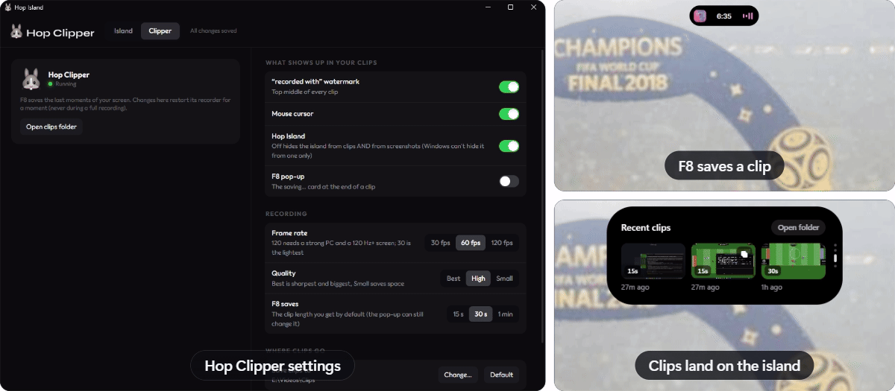
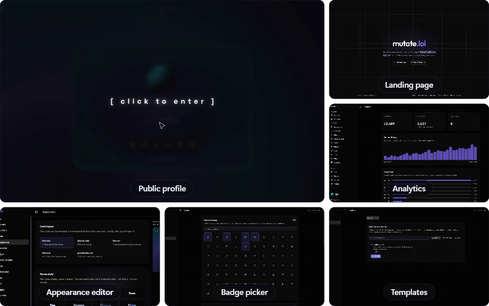
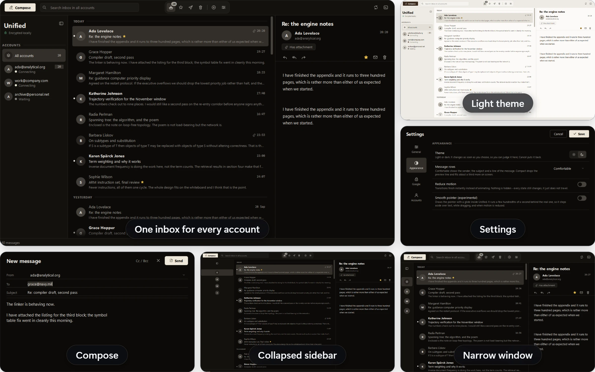
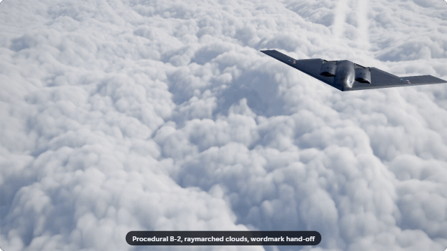
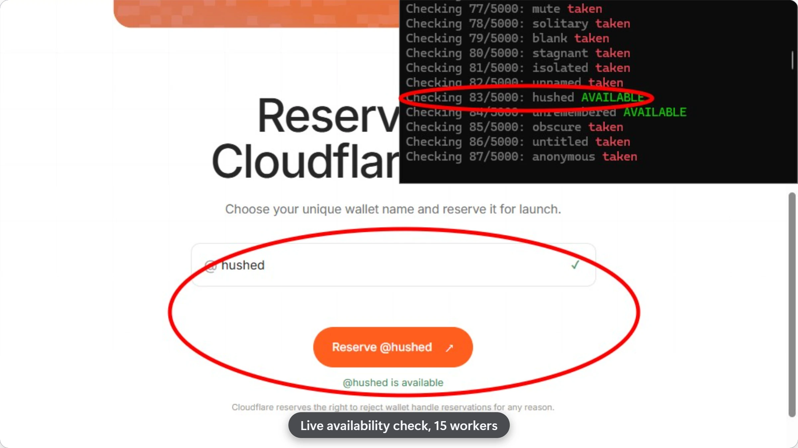

<picture>
  <source media="(prefers-color-scheme: dark)" srcset="assets/banner-dark.gif">
  
</picture>

 

## Hop

**An iPhone-style island and a lightweight clipper for Windows, in one install.**
[Repository](https://github.com/preinfection/hop) · [Download the installer](https://github.com/preinfection/hop/releases/latest)

<picture>
  <source media="(prefers-color-scheme: dark)" srcset="assets/hop-island-dark.gif">
  
</picture>

<picture>
  <source media="(prefers-color-scheme: dark)" srcset="assets/hop-clipper-dark.gif">
  
</picture>

`Python` `WebView2` `FFmpeg` `PyInstaller` `Inno Setup` · **1,238 tests**

 

## mutate.lol

**Free profile pages: everyone gets `mutate.lol/<username>`.**
[mutate.lol](https://mutate.lol) · [Status](https://status.mutate.lol)

<picture>
  <source media="(prefers-color-scheme: dark)" srcset="assets/mutate-dark.gif">
  
</picture>

`Next.js` `Cloudflare Pages & Workers` `D1` `KV` `R2` `Durable Objects` · **986 automated checks**

 

## Unified

**A Windows email client that puts several Gmail and IMAP accounts into one offline, encrypted inbox.**
[Repository](https://github.com/preinfection/unified)

`Python` `PySide6` `SQLite` · **594 tests**

 

## b2spirit

**A cinematic, fully procedural 3D opening for a landing page.**
[Repository](https://github.com/preinfection/b2spirit)

<picture>
  <source media="(prefers-color-scheme: dark)" srcset="assets/b2spirit-dark.gif">
  
</picture>

This GIF plays at 24 fps. The intro itself runs at your screen's refresh rate.

`TypeScript` `Three.js` `WebGL` `Vite`

 

## cloudflarewallet-reserve-checker

**Finds a free handle for Cloudflare Wallet using the site's own live availability check. It's read-only.**
[Repository](https://github.com/preinfection/cloudflarewallet-reserve-checker)

`Python` `requests`
