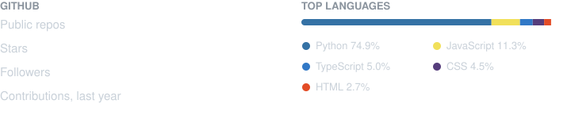

  

### about

hey, i'm pre. i'm from toronto and i like building things i actually end up using, mostly windows apps and websites. hop started because i wanted a little island at the top of my screen, and mutate.lol because i wanted a profile page i could make look however i want. if any of it is useful to you too, that's honestly the best part, and ideas or bug reports are always welcome.

🌐 [mutate.lol](https://mutate.lol) • [gethop.lol](https://gethop.lol) • [mathium.xyz](https://mathium.xyz) • [preinfection.lol](https://preinfection.lol)

---

### core skills

  

- **languages**: Python • TypeScript • JavaScript • SQL • GLSL
- **web**: Next.js • React • Tailwind • Cloudflare Pages & Workers • D1 • KV • R2 • Durable Objects
- **desktop**: PySide6 / Qt • WebView2 • FFmpeg • PyInstaller • Inno Setup
- **graphics**: Three.js • WebGL • raymarching
- **tools**: Git • SQLite • Windows

---

### stats

- **hop**: 1,238 tests
- **mutate.lol**: 986 automated checks

---

### projects

#### [gethop.lol](https://gethop.lol)
an iphone-style island and a lightweight clipper for windows, in one install.
- music, pc stats, today and clips, right at the top of the screen
- one key saves the last moments of a game as a clip
- [repository](https://github.com/preinfection/hop) • [download](https://github.com/preinfection/hop/releases/latest)

#### [mutate.lol](https://mutate.lol)
free profile pages: everyone gets `mutate.lol/<username>`.
- a full dashboard to style your page, with templates, badges and analytics
- provably fair games, animated collectibles and badges at games.mutate.lol
- runs entirely on cloudflare: pages, workers, d1, kv and r2 • [status](https://status.mutate.lol)
